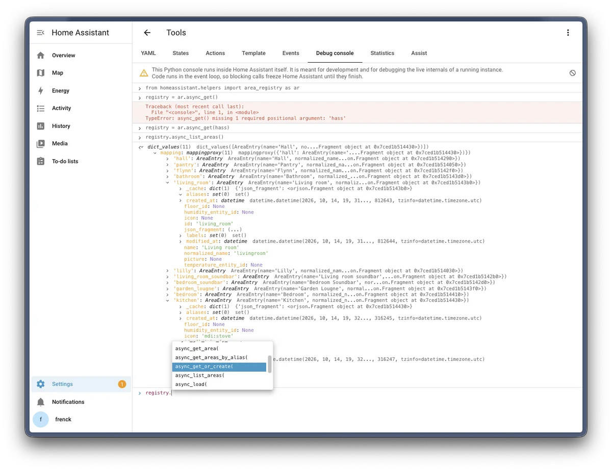

Debugging Home Assistant often means adding a log line, restarting, and trying again. Or attaching a debugger to look around. Starting with Home Assistant 2026.11, there is a quicker way to look inside a running instance: the debug console.

It is a Python console in the Tools panel, much like the console in the developer tools of your web browser. You run code inside Home Assistant itself, with `hass` available, and look at what comes back.



## Enable it

The debug console is off until you enable it in YAML, on every version:

```yaml title="configuration.yaml"
debug_console:
```

Restart Home Assistant, and administrators find it under **Settings** > **Tools** > **Debug console**. In the development container, `script/setup` adds this line for you.

It is YAML only on purpose. Code in the browser of an administrator, like a custom card, can do anything the user interface can do. If the console could be enabled from the user interface, such code could enable it too, and run Python unnoticed.

## What it can do

```python
hass.states.get("sun.sun")
```

- `await` works at the top level, so you can call asynchronous code directly.
- Results are objects you can expand, like in a browser console. Properties only run when you select them, as reading them can have side effects.
- `print()` works like `console.log`: objects you print can be expanded too.
- It completes names, attributes, imports, and keyword arguments while you type, and shows the signature of the function you are calling. None of that runs your code: completion reads everything statically.
- Code that waits does not hold up the console. Run `await event.wait()`, and you can still run `event.set()` next. **Stop** cancels code that is still running.
- Variables are kept per browser tab, also when you reload the page.

## Safeguards

Running code inside Home Assistant is powerful, and that cuts both ways. "Paste this into the console" is a common way to trick people, so:

- Each administrator accepts a warning before using the console.
- Pasting is blocked until you type `allow pasting`, like in a browser console.
- Everything that runs is written to the Home Assistant log, with who ran it.

## Things to keep in mind

Code runs in the event loop of Home Assistant. A blocking call, like `time.sleep()`, freezes Home Assistant until it finishes, and **Stop** cannot interrupt it. Use `await`, or run blocking work with `await hass.async_add_executor_job(...)`.

The console is for development and debugging, not for building on. Nothing you set up there survives a restart.

Read more in the [Debug console documentation](https://www.home-assistant.io/integrations/debug_console/), and on the [development environment](/core/development/environment/) page.
