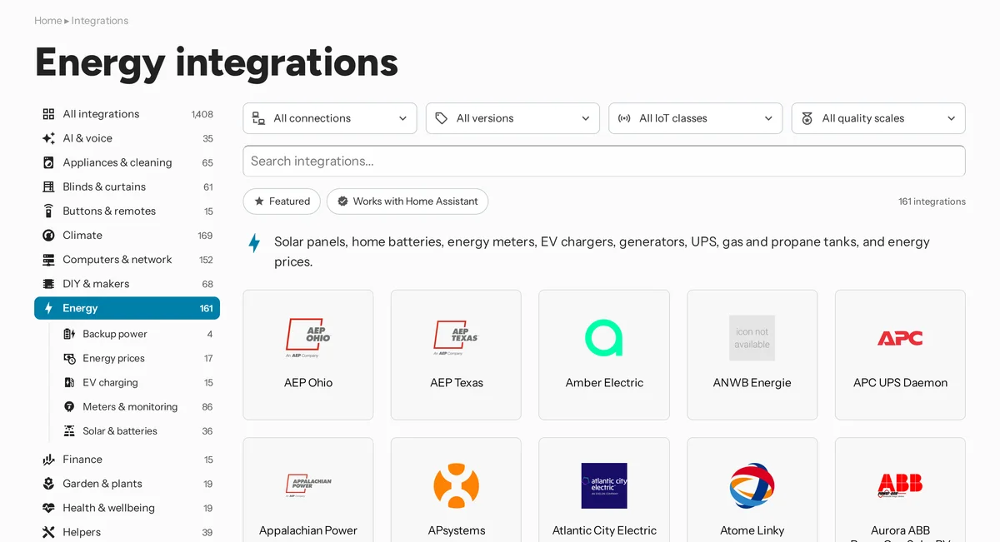

Home Assistant has well over 1,500 integrations. Finding the right one meant knowing its name, or scrolling a list of things like Sensor and Switch. That tells you which entities an integration creates, not what it is.

So integrations have categories now: 28 of them, like Lighting, Climate, and Energy, most with subcategories, like Energy › EV charging. A category says what an integration is for.



## In core

Every integration in core lists one to three categories in the `categories` key of its [manifest](/core/integrations/manifest/#categories). Hassfest checks them, and requires them for every integration people browse for. Entity and system integrations have none. Virtual integrations show the categories of the integration they point to.

The integrations page on [home-assistant.io](https://www.home-assistant.io/integrations/) browses by them, with a page for every category and subcategory. On documentation pages, `ha_categories` replaces the old `ha_category`.

Picking them comes down to one question: what is this, and where would someone look for it? A thermostat brand is Climate, even when it also creates sensors and switches. [Integration categories](/core/integrations/categories/) has the full list, and how to choose.

## Custom integrations

Custom integrations can use the same key:

```json title="manifest.json"
{
  "categories": ["energy.ev_charging"]
}
```

For a custom integration, it's optional. Hassfest only warns about a category it doesn't know, so a category that changes in core doesn't fail your build. The [HACS action](https://github.com/hacs/action) warns when the key is missing, and fails on an unknown category.

The catalog already picks the categories up from your manifest. Next, the Marketplace browses by them too, the same way the integrations page does. Add yours now, and your integration shows up in the right place from the start.
