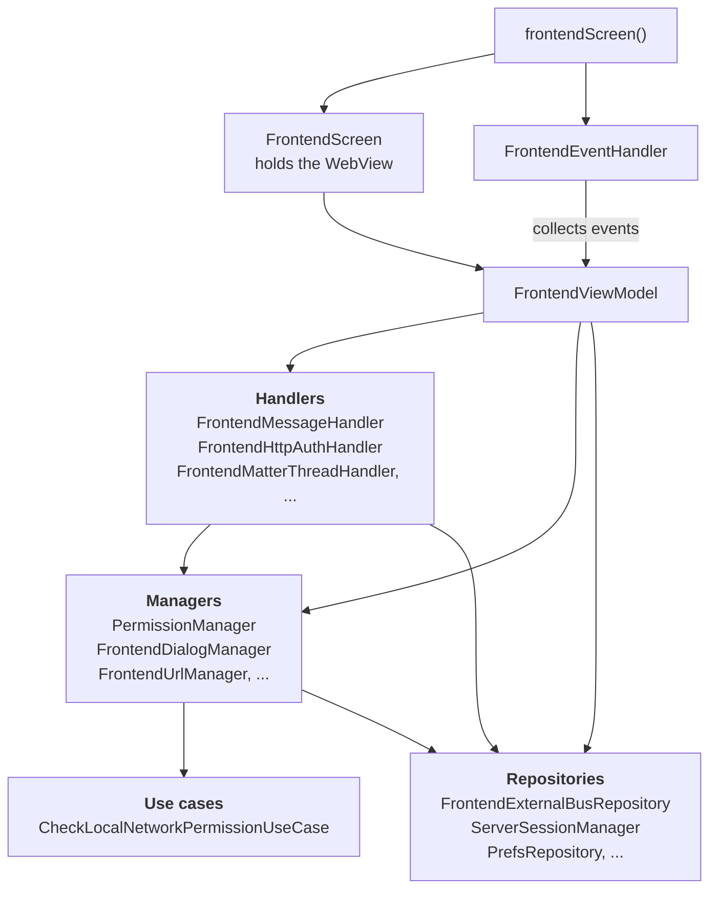
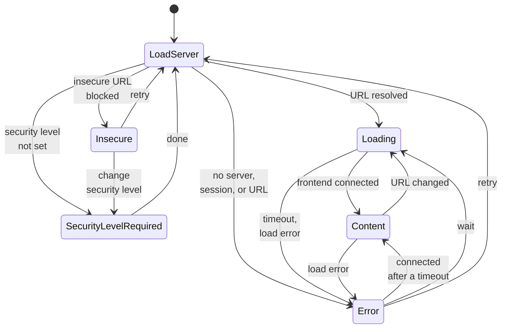
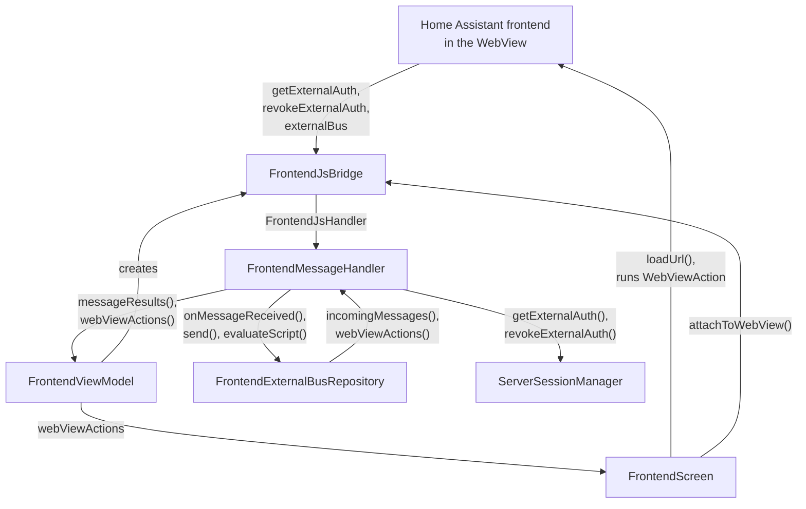

The frontend screen shows the Home Assistant frontend inside a [WebView](https://developer.android.com/reference/android/webkit/WebView), wrapped with native features: authentication, gestures, downloads, NFC, Matter and Thread, and media playback. It is the most complex screen in the app, and the reference implementation of the [UI architecture](/companion/android/ui-architecture/). Its inputs come from everywhere at once: the user, the web view, the external bus, system callbacks, and timeouts. That is exactly the situation the pattern is made for. The code lives in the [`frontend/`](https://github.com/home-assistant/android/tree/main/app/src/main/kotlin/io/homeassistant/companion/android/frontend) package. The older `webview/` package is the legacy implementation that is being removed.

## The pieces

| Role in the pattern | Frontend implementation |
| --- | --- |
| Navigation and events | `frontendScreen()`, `FrontendEventHandler` |
| View | `FrontendScreen`, `FrontendScreenContent` |
| ViewModel | `FrontendViewModel` |
| State | `FrontendViewState` |
| Events | `FrontendEvent` |
| Actions | `WebViewAction` |
| Prompts | `SingleSlotQueue` with `FrontendDialog`, `PermissionRequest`, `FileChooserRequest` |
| Handlers | `FrontendMessageHandler`, `FrontendMatterThreadHandler`, `FrontendHttpAuthHandler`, `FrontendFileChooserHandler`, and more |
| Managers | `PermissionManager`, `FrontendDialogManager`, `FrontendUrlManager`, `FrontendDownloadManager`, `FrontendGestureManager`, `FrontendExoPlayerManager`, and more |
| Repositories | `FrontendExternalBusRepository`, `ServerSessionManager` |

Their dependencies follow the layers of the pattern, and only point down:



At runtime, results flow back up through the flows each layer exposes. Managers push pending state that the screen renders, handlers push results that the ViewModel reduces, and repositories emit typed messages that the handlers consume.

## States and overlays

`FrontendScreen` always renders the web view at the bottom, and draws one overlay on top depending on the state. The web view stays mounted underneath, so it keeps its page when the overlay changes.

| State | Overlay |
| --- | --- |
| `LoadServer`, `Loading` | Loading indicator |
| `Content` | None, the frontend shows through |
| `SecurityLevelRequired` | The connection security level setup |
| `Insecure` | The insecure connection screen |
| `Error` | The connection error screen |

`LoadServer` is the entry point. It also blanks the web view, by loading `about:blank`, while the ViewModel resolves the URL to load. From there it moves to `Loading`, `Insecure`, `SecurityLevelRequired`, or `Error`. `Loading` moves to `Content` once the frontend connects over the external bus. Servers from 2026.8 also report when the frontend has finished rendering, and the loading indicator stays up until then. A timeout or load error moves to `Error`, and a retry goes back to `LoadServer`. Switching servers also re-enters `LoadServer`. One kind of error can't be retried: a `FrontendConnectionError.Unrecoverable`, like the system WebView failing to start. The ViewModel ignores any transition out of that `Error` state.

The main transitions between the states:



### Reusing the error screen

The connection error screen is shared with onboarding, so it can't depend on `FrontendViewModel`. It depends on a small interface with only what it needs, `FrontendConnectionErrorStateProvider`:

```kotlin
interface FrontendConnectionErrorStateProvider {
    val urlFlow: StateFlow<String?>
    val errorFlow: StateFlow<FrontendConnectionError?>
    val connectivityCheckState: StateFlow<ConnectivityCheckState>
    fun runConnectivityChecks()
}
```

`FrontendConnectionErrorScreen` is written against this interface. `FrontendViewModel` implements it, so the error overlay gets the ViewModel itself as its provider. Previews and tests use `FrontendConnectionErrorStateProvider.noOp`.

That is the general trick for reusing UI or logic across screens: define an interface for exactly what the reusable part needs, and let each ViewModel implement it. The dependency then points at the interface, not at one specific ViewModel.

## The web view

`FrontendScreen` creates the web view through `HAWebView`, a reusable composable. It creates the platform `WebView` inside an `AndroidView`, applies the base settings, sends the back button to the web view history before the navigation host, and shows a placeholder in previews and screenshot tests. When creating the web view fails, it reports that, and the ViewModel turns it into the unrecoverable `Error` state.

On top of that, `FrontendScreen` adds what only the frontend needs: it attaches the two clients below, enables cookies (including third-party cookies, which some integrations rely on), and wires up downloads and the gesture listener.

The ViewModel creates the two clients of the web view:

- `HAWebViewClient` comes from `HAWebViewClientFactory`. It handles TLS client certificates, maps load and TLS errors, reports finished page loads, surfaces HTTP basic auth challenges, and recovers when the renderer crashes.
- `HAWebChromeClient` comes from `viewModel.createWebChromeClient()`. It handles camera and microphone permission requests, JavaScript `confirm()` dialogs, the file chooser, and full screen video.

> [!NOTE]
> A ViewModel normally holds no platform UI types. These clients are the one accepted exception, because they are wired to ViewModel logic: error mapping, page load callbacks, HTTP auth, and permissions. It doesn't cost testability: the web view client comes from a factory that a test can fake, and the chrome client is only built when the screen asks for it. The reduction logic of the ViewModel still runs as a plain JVM unit test.

## Talking to the frontend

The frontend and the app talk over a JavaScript bridge. It carries two things:

- **External authentication**: the frontend asks the app for an access token instead of showing a login page.
- **The external bus**: messages in both directions, for example to open the native settings, scan a QR code, or start Assist.

The frontend side is documented in [external authentication](/frontend/reference/external-auth/) and [the external bus](/frontend/reference/external-bus/).

`FrontendJsBridge` is the JavaScript interface registered in the web view. It parses calls from the frontend into typed messages and hands them to `FrontendMessageHandler`. `FrontendExternalBusRepository` owns the bus itself: it deserializes incoming JSON, tolerating message types it doesn't know, and turns outgoing messages into scripts.

Nothing below `FrontendScreen` touches the web view. Everything else talks through flows:



In words:

- **Frontend to app**: the frontend calls the bridge, the handler passes the message to the repository, and the result flows back to the ViewModel as a typed event.
- **App to frontend**: a component sends a typed message to the repository, which wraps it in a `WebViewAction.EvaluateScript`. `FrontendScreen` runs it in the web view.
- **Authentication**: the frontend calls `getExternalAuth` or `revokeExternalAuth`, the handler asks `ServerSessionManager`, and the callback script runs in the web view. The bridge checks the callback name before it passes the call on.

The action and event flows are `SharedFlow`s with a small extra buffer, so a sender doesn't have to wait while the web view is still busy with an earlier command. They don't replay, though: a command sent while nothing collects the flow is dropped.

### Two bridge versions

The bridge exists in two versions:

- **V1** (`window.externalApp`) uses `addJavascriptInterface`. The frontend calls named methods directly.
- **V2** (`window.externalAppV2`) uses `WebViewCompat.addWebMessageListener`, for Home Assistant 2026.4.2 and later. All messages go through `postMessage` as JSON with a `type`, with filtering on origin and frames for security.

The app uses V2 when the server is new enough and the device's WebView supports the `WEB_MESSAGE_LISTENER` feature. Otherwise, it falls back to V1.

## Scoping

The blocks of one screen session are `@ViewModelScoped`. That includes `FrontendExternalBusRepository`: the bus only exists for one web view, so buffered messages from one visit can't leak into the next. `FrontendHandlerModule` binds `FrontendMessageHandler` as both `FrontendJsHandler` and `FrontendBusObserver` in the `ViewModelComponent`, so both roles share one instance.

## Testing

| What | Test type |
| --- | --- |
| `FrontendViewModel` | Unit tests with JUnit and Turbine |
| Managers and handlers | Unit tests, one concern at a time |
| `FrontendScreenContent` | Compose UI tests, per state |
| `FrontendEventHandler` | Compose UI tests, one per event |
| `FrontendScreen` | Screenshot tests, for looks only, no logic |
