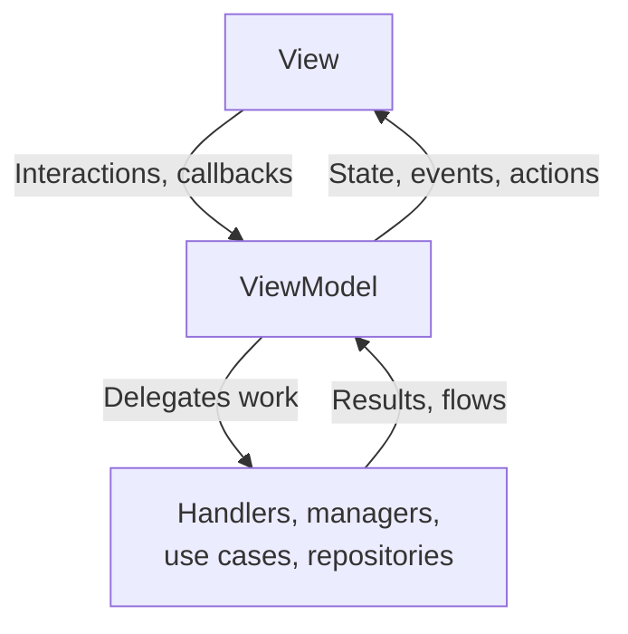
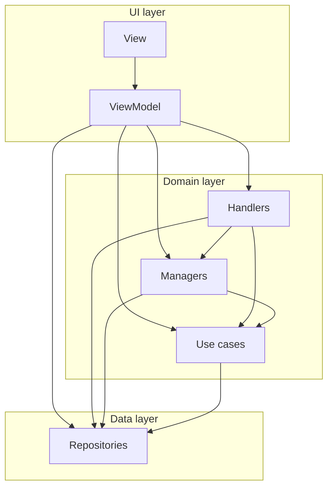

Every new screen follows the same pattern. It is an MVI-like take on Google's [recommended app architecture](https://developer.android.com/topic/architecture): the same UI, domain, and data layers, with a strict contract for how inputs and outputs flow. Existing screens are migrated to it over time. The [frontend screen](/companion/android/frontend-screen/) is the reference implementation.

## Why this pattern

A screen has many inputs at once: the user, system callbacks like permission results, timers, and external messages. The pattern reduces all of them to a few well-defined outputs, so the screen stays predictable and testable.

It also keeps screens small. Without structure, a screen grows into a ViewModel that knows everything and can't be tested or changed safely. Here, each concern lives in its own small block with one job.

## The flow

Inputs go down into the ViewModel. The ViewModel delegates work to blocks below it, and reduces their results into up to three outputs that flow back up to the view. The data goes around in one direction only:



The three outputs:

| Output | What it is | Example |
| --- | --- | --- |
| State | What to render. One value, always current | The list of servers, a loading flag |
| Events | One-shot effects that must happen exactly once | Navigate back, show a snackbar |
| Actions | Commands for an object only the view holds | Reload the web view, scroll to top |

Most inputs produce just a new state. Most screens never need actions.

## The view

The view is the Compose screen. It renders the state, reports interactions through callbacks, and owns any UI handles the lower layers must not touch, like a `WebView` or a `LazyListState`.

Split every screen into a stateful entry point and a stateless content composable. Previews, screenshot tests, and Compose tests then drive the content directly:

```kotlin
@Composable
internal fun SettingsScreen(viewModel: SettingsViewModel) {
    val viewState by viewModel.viewState.collectAsStateWithLifecycle()

    SettingsScreenContent(
        viewState = viewState,
        onNameChange = viewModel::onNameChange,
    )
}

@Composable
internal fun SettingsScreenContent(
    viewState: SettingsViewState,
    onNameChange: (String) -> Unit,
) {
    // Renders viewState, reports interactions through the callbacks
}
```

## The ViewModel

The ViewModel owns the outputs and wires the blocks together:

```kotlin
val viewState: StateFlow<UiState> // what to render
val events: Flow<UiEvent>         // one-shot effects, from a Channel
val actions: Flow<UiAction>       // only if the view owns a handle
```

Rules:

- It never references Compose or platform UI types, so its logic runs as a plain JVM unit test.
- It outlives configuration changes. `viewModelScope` is only cancelled when the screen is gone for good, so a rotation does not restart loading or flow collection.
- Keep it thin. A small screen can keep its logic in the ViewModel. When it grows, move cohesive logic into the [blocks](#the-blocks) below.

### State

The state is the single source of truth for what is on screen.

- **Immutable.** Use `val` and immutable collections, and make changes with `copy()`. In-place mutation breaks change detection in Compose.
- **Structural equality.** Use a data class. `StateFlow` skips values equal to the current one, so emitting the same state again costs nothing.
- **Cheap to read.** Compose reads the state on the main thread, on every recomposition. Never compute in a getter. Compute when you build the state, on a background dispatcher:

```kotlin
// Bad: maps the list on every recomposition, on the main thread
data class UiState(val servers: List<Server>) {
    val serverItems: List<HADropdownItem<Int>>
        get() = servers.map { HADropdownItem(it.id, it.friendlyName) }
}

// Good: mapped once, when the state is created
data class UiState(val serverItems: List<HADropdownItem<Int>>)
```

Shape the state to the screen. One data class works when the screen always looks the same. When the screen has distinct modes, use a sealed hierarchy, so the compiler forces you to handle each mode and fields of one mode can't leak into another:

```kotlin
sealed interface UiState {
    data object Loading : UiState
    data class Content(val items: List<Item>) : UiState
    data class Error(val error: ErrorReason) : UiState
}
```

### Events

Events are fire-and-forget: navigate, show a snackbar, open a link. Model them as a sealed interface, so the handler's `when` is exhaustive:

```kotlin
sealed interface UiEvent {
    data object NavigateBack : UiEvent
    data class ShowSnackbar(@StringRes val messageResId: Int) : UiEvent
}
```

Send them through a `Channel`, exposed as a `Flow` with `receiveAsFlow()`, and consume each one once, usually in the navigation layer. The buffered `Channel` holds events for its single consumer, so an event sent before the collector starts still arrives, where a `SharedFlow` without replay drops it. See [picking a flow type](/companion/android/architecture/#picking-a-flow-type). Never replay an event: replaying "navigate back" after a recomposition navigates twice. If the UI must show something again after rotation, it is state, not an event.

### Actions

Some objects must live in the view, because Compose creates them: a `WebView`, a `LazyListState`, a focus requester. The ViewModel can't hold them. Yet some operations on them are imperative, like "reload now".

For those, the ViewModel emits a typed action, and the view runs it against the object it owns. Each action carries its own `run`:

```kotlin
sealed interface WebViewAction {
    fun run(webView: WebView)

    data object Reload : WebViewAction {
        override fun run(webView: WebView) = webView.reload()
    }
}

// In the view, the only place that holds the WebView
LaunchedEffect(webView) {
    webViewActions.collect { action -> action.run(webView) }
}
```

The flow is a `SharedFlow` with a small extra buffer, consumed once. It doesn't replay: an action sent while the view is gone is dropped, which suits commands that only mean something for the object the view holds right now. When an action must not be dropped, wait for a collector first, like `FrontendViewModel` does with `subscriptionCount` before it emits. An action that needs a result can carry a `CompletableDeferred`.

An action is not state: a command held as state would run again on every recomposition. It is not an event either: an event is a signal the host reacts to, like navigating, while an action drives one object this screen owns.

Only use actions for objects that must live in the view. A media player, for example, can live in a manager and be exposed as state. In practice, a screen has at most one such object, and usually none.

### Choosing an output

Ask what the output is, not where it comes from:

| If the output | Use | Why |
| --- | --- | --- |
| Decides what is rendered, and must survive recomposition and rotation | State | Emitting the same value again is a no-op |
| Is a side effect that must happen exactly once | Event | Replaying it would navigate or show a snackbar twice |
| Is a command for an object the view holds | Action | The ViewModel stays free of UI types |
| Asks the user something and waits for the answer | Prompt in a manager | One prompt at a time, the caller suspends until the user answers |

## The blocks

The ViewModel delegates feature logic to four kinds of blocks. Name each class after its kind: `*Repository`, `*UseCase`, `*Manager`, `*Handler`.

| Block | What it is | May depend on |
| --- | --- | --- |
| Repository | The single source of truth for one data source or channel: storage, network, a Room DAO, an external bus | Data sources only, never another repository |
| Use case | One stateless, reusable operation, exposed as `operator fun invoke()` | Repositories |
| Manager | The logic and in-memory state of one feature concern | Repositories, use cases, platform APIs. Never another manager |
| Handler | Logic that coordinates one or more managers | Managers, use cases, repositories. Never another handler |

The difference between a manager and a handler is one question: does it depend on a manager? If yes, it is a handler. Whether it holds state, or translates one input versus driving a multi-step flow, does not matter: a handler can be any of those. That rule makes manager-to-manager dependencies impossible by definition.

A handler returns its work to the ViewModel as a sealed result, or as a flow of results. It may keep state for its own feature, which the ViewModel maps into the screen state. The state of the screen always belongs to the ViewModel.

A manager talks to the screen in three ways: it exposes pending state as a `StateFlow` the view renders, it returns a sealed result from a `suspend` function, or it exposes a `Flow` of results.

Managers are also where prompts live: a dialog, a permission request, or a file picker that waits for the user's answer. Use `SingleSlotQueue` for those. It shows one prompt at a time, exposes the current request as state, and lets the caller `awaitResult` until the user answers. A prompt is not a fourth output: it is pending state the view renders, with the answer coming back as a normal input.

Reach for a use case when logic is needed by more than one caller, or would bloat a ViewModel or manager, but has no state of its own. Examples are `CheckLocalNetworkPermissionUseCase` and `ServerChooserItemsUseCase`.

Database access also goes through a repository: the Room DAO is the data source, and the repository is what the rest of the app sees. Combining several data sources is logic, so it belongs in a use case, manager, or handler, not in a repository.

### Choosing a block

Work top to bottom. The first row that fits wins:

| You have | Use |
| --- | --- |
| Access to a data source or communication channel | Repository |
| One reusable operation without state | Use case |
| One feature concern with its own state | Manager |
| Logic that coordinates managers | Handler |
| Screen-wide state and coordination | ViewModel |

## Layers and dependencies

The view and the ViewModel are the UI layer. Handlers, managers, and use cases are the domain layer. Repositories are the data layer. Dependencies only point down:

- The ViewModel can use any block directly.
- Handlers use managers, use cases, and repositories.
- Managers use use cases and repositories.
- Use cases use repositories.
- No handler uses another handler. Coordinate handlers in the ViewModel.
- The ViewModel only extracts a handler once coordinating managers would otherwise bloat it.

The same rules as a graph, with every arrow pointing down:



Nothing points up or sideways. That keeps the graph free of cycles and every block testable on its own.

## Scoping

Scope a block to how long its state must live:

- A block that belongs to one screen is `@ViewModelScoped`. Everything in that screen session shares one instance, and it resets when the session ends.
- A block that represents an app-wide concern is usually `@Singleton`.

Shared instances matter. If the ViewModel and a handler both inject a stateful manager, they must get the same object, or their view of the state drifts apart. An unscoped binding gives each consumer its own copy. This is where being stateful matters: a block with state needs a scope that matches how long that state lives.

Provide everything through Hilt. Never create these blocks by hand.

## Testing

The split is what makes screens testable:

| Layer | Test type | What to check |
| --- | --- | --- |
| ViewModel | Unit | Which input produces which state, event, or action |
| Handlers, managers, use cases | Unit | Each concern on its own |
| Stateless content | Compose UI | Rendering per state, and that interactions call the right callback |
| Event handling | Compose UI | Each event triggers the right navigation or effect |
| Screen | Screenshot | Looks only, no logic |

See [testing](/companion/android/testing/) and [screenshot tests](/companion/android/screenshot-testing/).
