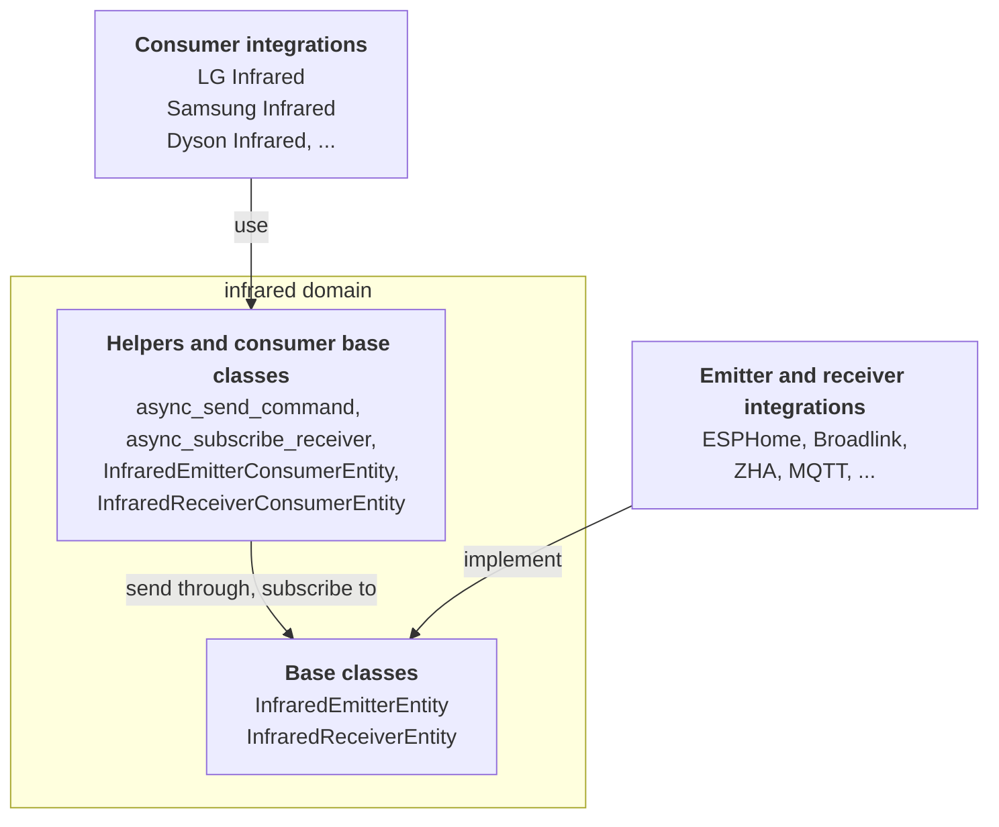

The infrared domain splits infrared control in two. Some integrations own the hardware: an ESPHome board or a Broadlink hub with an IR LED or an IR receiver. Other integrations know a device: which codes turn on a Dyson fan, or switch the input of an Edifier speaker. With the infrared domain in between, a device integration works with any IR hardware, and a hardware integration does not have to know a single device.

There are three roles:

- **Emitter integrations** own hardware that sends IR signals. They provide an entity based on `InfraredEmitterEntity`.
- **Receiver integrations** own hardware that picks up IR signals. They provide an entity based on `InfraredReceiverEntity`.
- **Consumer integrations** know a device and its codes. They do not create infrared entities. They create regular entities, like a [button](/core/entities/button/), a [fan](/core/entities/fan/), or a [media player](/core/entities/media-player/), and send or receive through an emitter or receiver the user picked, usually in the config flow.

How the roles connect through the infrared domain:



Everything lives in `homeassistant.components.infrared`. The commands themselves come from the [`infrared-protocols`](https://github.com/home-assistant-libs/infrared-protocols) library. For the same pattern with radio signals, see the [radio frequency entity](/core/entities/radio-frequency/).

## Properties

Infrared entities have no properties of their own to implement. The generic properties every entity has are on [the entity class](/core/entities/entity-class/).

The base classes set a few things for you:

| Name | Value | Description |
| --- | --- | --- |
| `device_class` | `InfraredDeviceClass.EMITTER` or `InfraredDeviceClass.RECEIVER` | Set by the base class. An entity without a name is named after its device class. |
| `should_poll` | `False` | Infrared entities never poll. |
| `state` | Final | The time of the last command sent or signal received. See [States](#states). |

Both base classes extend `RestoreEntity`, so the last timestamp survives a restart.

## Supported features

Infrared entities have no supported features. An entity is either an emitter or a receiver. If your hardware does both, create one entity of each.

## Emitter

Implement `async_send_command`. It receives an `InfraredCommand` (the `Command` base class of `infrared-protocols`, re-exported by the infrared domain) and must send it, or raise `HomeAssistantError` when that fails. Everything you need is on the command: `modulation` is the carrier frequency in Hz, and `get_raw_timings()` returns the timings in microseconds (positive values are pulses, negative values are spaces).

```python
class MyInfraredEmitter(InfraredEmitterEntity):
    async def async_send_command(self, command: InfraredCommand) -> None:
        """Send an IR command."""
```

Do not call this method from other code. Consumers go through the `async_send_command` helper, which validates the entity, passes the context, and updates the state after a successful send.

## Receiver

There is no method to implement on a receiver. When your hardware picks up a signal, hand it to the base class with `_handle_received_signal`. The base class updates the state and calls every subscriber.

```python
class MyInfraredReceiver(InfraredReceiverEntity):
    @callback
    def _on_hardware_signal(self, timings: list[int]) -> None:
        """Pass a signal from the hardware on to subscribers."""
        self._handle_received_signal(InfraredReceivedSignal(timings=timings))
```

`InfraredReceivedSignal` holds `timings` (a list of `int`) and an optional `modulation`. Call `_handle_received_signal` from the event loop.

## Consumer helpers

Consumers never hold a reference to an infrared entity. They work with entity IDs (or registry IDs) and these helpers:

| Helper | Description |
| --- | --- |
| `async_get_emitters(hass)` | The entity IDs of all emitter entities. Use it to offer a choice in your config flow. |
| `async_get_receivers(hass)` | The entity IDs of all receiver entities. |
| `async_send_command(hass, entity_id_or_uuid, command, context=None)` | Sends a command through an emitter. Raises `HomeAssistantError` when the infrared domain is not loaded or the emitter does not exist. |
| `async_subscribe_receiver(hass, entity_id_or_uuid, signal_callback)` | Calls `signal_callback` with an `InfraredReceivedSignal` for every signal. Returns a callback to unsubscribe. Raises `HomeAssistantError` when the infrared domain is not loaded or the receiver does not exist. |

Most consumers do not need the helpers directly, because two base classes do the work for them:

- `InfraredEmitterConsumerEntity`: set `_infrared_emitter_entity_id`, then call `await self._send_command(command)`. The entity is only available while the emitter is, and the context of the action is passed on.
- `InfraredReceiverConsumerEntity`: set `_infrared_receiver_entity_id` and implement the `_handle_signal(signal)` callback. The base class subscribes while the receiver is available, and unsubscribes when it goes away or the entity is removed.

Mix them in before the entity class of your platform, like `class MyButton(InfraredEmitterConsumerEntity, ButtonEntity)`. When you override `_async_infrared_availability_changed` to react to availability, call `super()` first.

> [!NOTE]
> `InfraredEntity` and `InfraredEntityDescription` are deprecated aliases of the emitter classes, and stop working in Home Assistant 2027.6. Use `InfraredEmitterEntity` and `InfraredEmitterEntityDescription`.

## Methods

| Role | Method | Description |
| --- | --- | --- |
| Emitter | `async_send_command(command)` | Required. Send the command to the hardware. There is no sync variant. |
| Receiver | none | Call `_handle_received_signal(signal)` when a signal arrives. |
| Receiver consumer | `_handle_signal(signal)` | Required. A callback that handles a received signal. |

## States

The state of an emitter is the time the last command was sent. The state of a receiver is the time the last signal was received. Both are ISO 8601 timestamps with milliseconds, like `2026-10-10T08:15:00.123+00:00`, or `unknown` before the first one. The state is final: the base classes manage it.

## Example

A consumer button that turns on a TV through an emitter the user picked in the config flow.

```python
from infrared_protocols.commands.nec import NECCommand

from homeassistant.components.button import ButtonEntity
from homeassistant.components.infrared import InfraredEmitterConsumerEntity

POWER_ON = NECCommand(address=0x04, command=0x08)


class MyTvPowerButton(InfraredEmitterConsumerEntity, ButtonEntity):
    """Turn on the TV over infrared."""

    _attr_has_entity_name = True
    _attr_translation_key = "power_on"

    def __init__(self, entry_id: str, emitter_entity_id: str) -> None:
        """Initialize the button."""
        self._attr_unique_id = f"{entry_id}_power_on"
        self._infrared_emitter_entity_id = emitter_entity_id

    async def async_press(self) -> None:
        """Send the power on code."""
        await self._send_command(POWER_ON)
```
