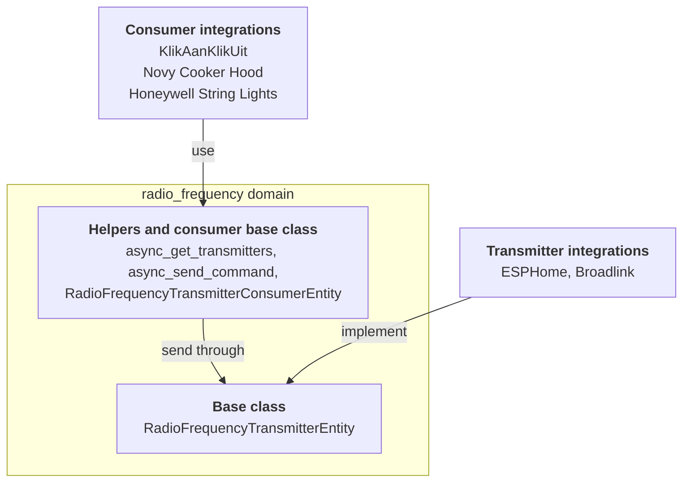

The radio frequency domain sits between RF hardware and the devices it controls. Plenty of cheap devices listen to simple radio codes on 433 MHz or 868 MHz: garage doors, wireless sockets, string lights, cooker hoods. One integration owns the radio, like an ESPHome board or a Broadlink hub. Another integration knows a device and the codes it listens to. The radio frequency domain lets them work together without knowing about each other.

There are two roles:

- **Transmitter integrations** own hardware that sends RF signals. They provide an entity based on `RadioFrequencyTransmitterEntity`.
- **Consumer integrations** know a device and its codes. They do not create radio frequency entities. They create regular entities, like a [switch](/core/entities/switch/) or a [light](/core/entities/light/), and send through a transmitter the user picked, usually in the config flow.

How the roles connect through the radio frequency domain:



Everything lives in `homeassistant.components.radio_frequency`. The commands come from the [`rf-protocols`](https://github.com/home-assistant-libs/rf-protocols) library, and the domain re-exports its `RadioFrequencyCommand` and `ModulationType`. Unlike the [infrared entity](/core/entities/infrared/), there is no receiver role: radio frequency entities only transmit.

## Properties

These properties are specific to radio frequency entities. The generic properties every entity has are on [the entity class](/core/entities/entity-class/).

| Name | Type | Default | Description |
| --- | --- | --- | --- |
| `supported_frequency_ranges` | `list[tuple[int, int]]` | Required | The frequency ranges the hardware can transmit on, as `(min_hz, max_hz)` tuples. It is an abstract property: implement it as a property, not as an `_attr_` attribute. |

The base class sets `should_poll` to `False` and manages the state. It extends `RestoreEntity`, so the time of the last command survives a restart.

## Supported features

Radio frequency entities have no supported features. What a transmitter can do is described by its frequency ranges and its modulation. Right now, the only modulation is `ModulationType.OOK` (on-off keying), and every transmitter is assumed to support it.

## Transmitter

A transmitter implements two things: the frequency ranges, and sending a command.

`async_send_command` receives a `RadioFrequencyCommand`. Read what you need from it: `frequency` in Hz, `modulation`, `repeat_count`, the optional `symbol_rate` and `output_power`, and `get_raw_timings()`, which returns the signal as alternating pulses (positive) and spaces (negative) in microseconds. Raise `HomeAssistantError` when sending fails.

Do not call `async_send_command` on the entity from other code. Consumers go through the `async_send_command` helper, which checks the frequency and modulation, passes the context, and updates the state after a successful send.

## Consumer helpers

Consumers never hold a reference to the transmitter entity. They work with an entity ID (or its registry ID) and these helpers:

| Helper | Description |
| --- | --- |
| `async_get_transmitters(hass, frequency, modulation)` | The entity IDs of all transmitters that support the frequency and modulation. An empty list means none of them fit. Raises `HomeAssistantError` when the domain is not loaded or there are no transmitters at all. |
| `async_send_command(hass, entity_id_or_uuid, command, context=None)` | Sends a command through a transmitter. Raises `HomeAssistantError` when the domain is not loaded, the transmitter does not exist, or it does not support the frequency or modulation of the command. |

The `RadioFrequencyTransmitterConsumerEntity` base class does the bookkeeping for you. Set `_rf_transmitter_entity_id` to the entity ID of the transmitter and call `await self._send_command(command)`. The base class keeps your entity available only while the transmitter is available, and passes on the context of the action. Mix it in before the entity class of your platform.

For config flows and the frontend, there is also a `radio_frequency/list` WebSocket command (admin only). It lists every transmitter with its device, config entry, frequency ranges, and supported modulations.

## Methods

| Method | Description |
| --- | --- |
| `async_send_command(command)` | Required. Send the command over the air. There is no sync variant. |
| `supported_frequency_ranges` | Required property. Return the `(min_hz, max_hz)` ranges. |

`supports_frequency` and `supports_modulation` are final: the base class implements them from the frequency ranges and the modulation.

## States

The state is the time the last command was sent, as an ISO 8601 timestamp with milliseconds, like `2026-10-10T08:15:00.123+00:00`, or `unknown` before the first one. It is final: the base class manages it.

## Example

A transmitter for a 433 MHz radio on a network hub.

```python
from homeassistant.components.radio_frequency import (
    RadioFrequencyCommand,
    RadioFrequencyTransmitterEntity,
)
from homeassistant.exceptions import HomeAssistantError


class MyRfTransmitter(RadioFrequencyTransmitterEntity):
    """The 433 MHz radio of a hub."""

    _attr_has_entity_name = True
    _attr_translation_key = "rf_transmitter"

    def __init__(self, hub: MyHub) -> None:
        """Initialize the transmitter."""
        self._hub = hub
        self._attr_unique_id = f"{hub.serial}_rf"

    @property
    def supported_frequency_ranges(self) -> list[tuple[int, int]]:
        """Return the bands this radio can transmit on."""
        return [(433_050_000, 434_790_000)]

    async def async_send_command(
        self, command: RadioFrequencyCommand
    ) -> None:
        """Send the command."""
        try:
            await self._hub.send_rf(
                frequency=command.frequency,
                timings=command.get_raw_timings(),
                repeat=command.repeat_count,
            )
        except MyHubError as err:
            raise HomeAssistantError(f"Sending failed: {err}") from err
```

On the consumer side, a switch for a wireless socket is a few lines on top of `RadioFrequencyTransmitterConsumerEntity`:

```python
from typing import Any

from rf_protocols.commands.kaku import KakuCommand

from homeassistant.components.radio_frequency import (
    RadioFrequencyTransmitterConsumerEntity,
)
from homeassistant.components.switch import SwitchEntity


class MySocket(RadioFrequencyTransmitterConsumerEntity, SwitchEntity):
    """A wireless socket that listens to KlikAanKlikUit codes."""

    _attr_has_entity_name = True
    _attr_name = None
    _attr_assumed_state = True

    def __init__(
        self, entry_id: str, transmitter: str, code: int, channel: int
    ) -> None:
        """Initialize the socket."""
        self._attr_unique_id = entry_id
        self._rf_transmitter_entity_id = transmitter
        self._code = code
        self._channel = channel

    async def async_turn_on(self, **kwargs: Any) -> None:
        """Send the on code."""
        await self._send_command(
            KakuCommand(
                id=self._code, group=False, channel=self._channel, on=True
            )
        )
        self._attr_is_on = True
        self.async_write_ha_state()

    async def async_turn_off(self, **kwargs: Any) -> None:
        """Send the off code."""
        await self._send_command(
            KakuCommand(
                id=self._code, group=False, channel=self._channel, on=False
            )
        )
        self._attr_is_on = False
        self.async_write_ha_state()
```
