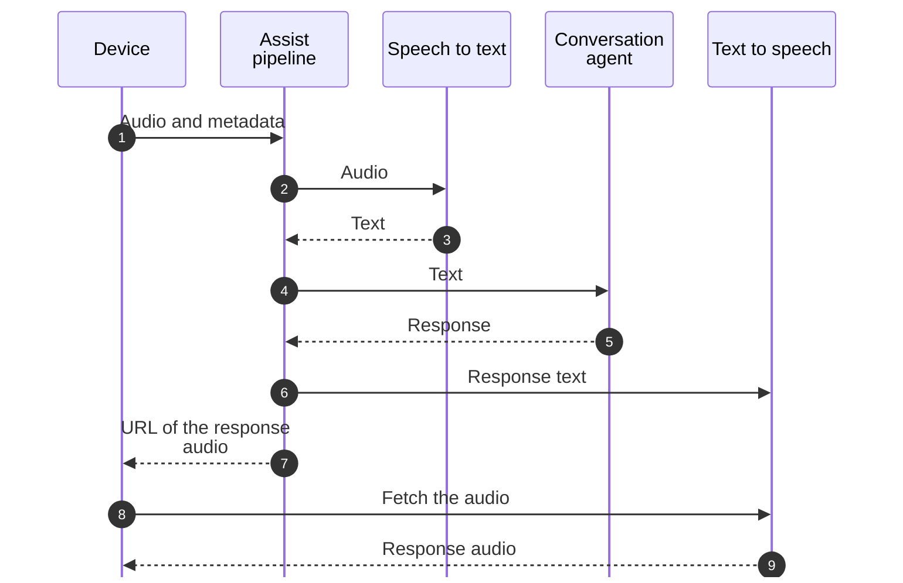
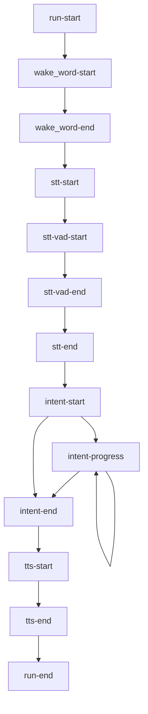

Voice in Home Assistant is a chain of small parts, each with one job. An [Assist pipeline](/glossary/assist-pipeline/) strings them together. A voice satellite, like a smart speaker, only has to capture audio and play back the answer: Home Assistant does the rest.

## How voice flows through Home Assistant

1. A device streams audio to the pipeline, with metadata like the sample rate.
2. **Wake word detection** listens for the wake word, like "Okay Nabu". Optional: many devices detect it themselves.
3. **Speech to text** turns the spoken command into text.
4. **Intent recognition** gives that text to a [conversation agent](/glossary/conversation-agent/). The built-in agent matches it to an [intent](/core/internals/intents/), which is handled, and returns a response. An agent backed by a language model gets there its own way.
5. **Text to speech** turns the response into audio.
6. The device plays the audio.

The same flow, step by step, for a device that detects the wake word itself:



Each part is its own integration, with a matching entity type that integrations provide:

- `assist_pipeline` runs the pipeline.
- `wake_word` detects wake words. Providers are [wake word entities](/core/entities/wake-word/).
- `stt` turns speech into text. Providers are [speech-to-text entities](/core/entities/stt/).
- `conversation` processes the text. Agents are [conversation entities](/core/entities/conversation/).
- `tts` turns text into speech. Providers are [text-to-speech entities](/core/entities/tts/).

Users set up pipelines under **Settings** > **Voice assistants**, picking a language and a provider for each step. A device that is a voice satellite is an [Assist satellite entity](/core/entities/assist-satellite/), which runs a pipeline for you.

## Run a pipeline

Clients that are not Assist satellite entities, like an app or a custom device, run a pipeline over the WebSocket API with `assist_pipeline/run`:

```json
{
  "id": 7,
  "type": "assist_pipeline/run",
  "start_stage": "stt",
  "end_stage": "tts",
  "input": {
    "sample_rate": 16000
  }
}
```

The [websocket-voice-assistant](https://github.com/OHF-Voice/websocket-voice-assistant) project is a complete example client.

| Field | Description |
| --- | --- |
| `start_stage` | Required. The first stage to run: `wake_word`, `stt`, `intent`, or `tts`. |
| `end_stage` | Required. The last stage to run: `stt`, `intent`, or `tts`. |
| `input` | Depends on the start stage. See below. |
| `pipeline` | The ID of the pipeline to run. Defaults to the preferred pipeline. `assist_pipeline/pipeline/list` lists them. |
| `conversation_id` | Continues an earlier conversation. See the [conversation API](/core/internals/conversation-api/#conversations). |
| `device_id` | The device, from the device registry, that starts the pipeline. |
| `timeout` | Seconds before the whole run times out. Defaults to 300. |

What goes in `input`:

- Starting at `wake_word`: `sample_rate` (required), `timeout` in seconds of silence before giving up (default 3), and the [audio enhancements](#audio-enhancements).
- Starting at `stt`: `sample_rate` (required), and optionally `wake_word_phrase`, the wake word that was detected on the device. Home Assistant uses it to avoid several devices answering the same wake word.
- Starting at `intent` or `tts`: `text`.

## Events

While it runs, the pipeline sends `event` messages over the connection, with the `id` of the run command. Each event has a `type` and `data`:

| Event | When | Data |
| --- | --- | --- |
| `run-start` | Always | `pipeline`, `language`, `conversation_id`, `runner_data` with `stt_binary_handler_id` and `timeout`, and `tts_output` with the `url` and `token` of the coming response audio, its `mime_type`, and `stream_response`. |
| `wake_word-start` | Audio only | The `engine`, the audio `metadata`, and the `timeout`. |
| `wake_word-end` | Audio only | `wake_word_output` with the `wake_word_id`, and the `timestamp` in milliseconds from the start of the audio. |
| `stt-start` | Audio only | The `engine` and the audio `metadata`. |
| `stt-vad-start` | Audio only | `timestamp` when the voice command started, in milliseconds from the start of the audio. |
| `stt-vad-end` | Audio only | `timestamp` when the voice command ended. |
| `stt-end` | Audio only | `stt_output` with the recognized `text`. |
| `intent-start` | Always | The `engine` (the agent), the `language`, and `intent_input`, the text. |
| `intent-progress` | Some agents | `chat_log_delta` with a piece of the response as the agent streams it, or `tts_start_streaming` when text to speech starts before the answer is complete. |
| `intent-end` | Always | `intent_output`, a [conversation response](/core/internals/conversation-api/#the-response), and `processed_locally`. |
| `tts-start` | Audio only | The `engine`, `language`, `voice`, and `tts_input`, the text to speak. |
| `tts-end` | Audio only | `tts_output` with the `url`, `token`, `mime_type`, and `media_id` of the audio. |
| `run-end` | Always | Nothing. |
| `error` | On error | A `code` and a `message`. |

### Event order

A full run, from the wake word to the spoken answer, sends the events in this order:



Not every run sends all of them:

- A run only sends the events of the stages between its `start_stage` and `end_stage`. A run that starts at `intent` with text goes from `run-start` straight to `intent-start`.
- `stt-vad-start` and `stt-vad-end` only come when Home Assistant detects the end of the voice command itself, for a speech-to-text provider that needs it.
- `intent-progress` only comes from agents that stream their response, and can come many times.
- When the response has no text to speak, the run skips text to speech and goes from `intent-end` to `run-end`, unless it plays the acknowledgement sound instead.
- When no wake word is heard before the audio ends, `wake_word-end` comes without a wake word, followed by `run-end`.
- When a stage fails, the run sends `error`, then `run-end`. No other events follow.

### Error codes

- `wake-engine-missing`: no wake word engine is installed.
- `wake-provider-missing`: the wake word provider is not available.
- `wake-stream-failed`: an error during wake word detection.
- `wake-word-timeout`: no wake word within the timeout.
- `stt-provider-missing`: the speech-to-text provider is not available.
- `stt-provider-unsupported-metadata`: the provider does not support the audio format, like the sample rate.
- `stt-stream-failed`: an error during speech to text.
- `stt-no-text-recognized`: speech to text returned nothing.
- `cloud-auth-failed`: Home Assistant Link could not authenticate.
- `intent-agent-not-found`: the conversation agent does not exist.
- `intent-not-supported`: the conversation agent is not available.
- `intent-failed`: an error during intent recognition.
- `tts-not-supported`: the text-to-speech provider is not available, or does not support the options.

## Send audio

Once you get `run-start`, send the audio as binary WebSocket messages, as soon as you have it. Start every message with one byte: the `stt_binary_handler_id` from `runner_data`. For handler ID `1` and the audio bytes `a1b2c3`, the message is, in hex:

```text
01a1b2c3
```

To mark the end of the audio, send a binary message with only the handler ID byte.

## Wake word detection

With `start_stage` set to `wake_word`, the pipeline waits until it hears the wake word, then carries on with speech to text. The `timeout` in `input` is the number of seconds of silence before it gives up with `wake-word-timeout`. While Home Assistant hears speech, the timeout keeps resetting.

Streaming audio all the time costs network and CPU. Use voice activity detection on the device, and only stream when someone speaks.

### Audio enhancements

When starting at `wake_word`, `input` can also have:

- `noise_suppression_level`: 0 (off) to 4 (maximum).
- `auto_gain_dbfs`: automatic gain, 0 (off) to 31 (maximum).
- `volume_multiplier`: multiplies the audio samples. 1.0 changes nothing, 2.0 doubles the volume.

For a quiet microphone, try `noise_suppression_level` 2, `auto_gain_dbfs` 31, and `volume_multiplier` 2.0. Turning up noise suppression or the multiplier too far distorts the audio.
