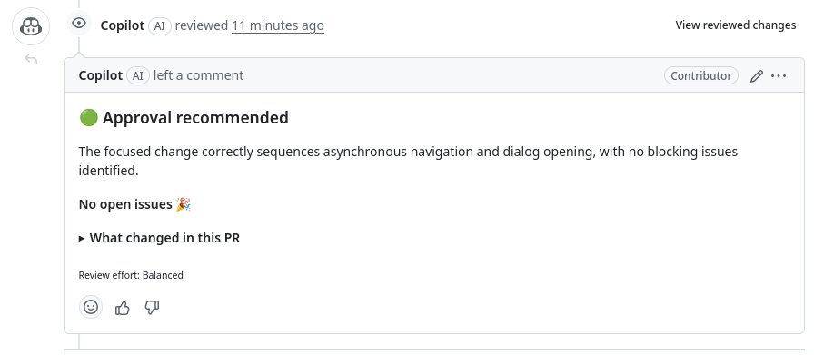

Your change works and the [checks](/frontend/development/testing/) pass. Here is what your pull request needs before a maintainer looks at it. The general steps for every repository are in [Pull requests and reviews](/start/pull-requests/).

## Open it when it's ready for review

Open a pull request when your change is done and you want a review, not to try something out.

Every pull request takes time from the people who triage, label, and review them, also when it's a draft. To experiment, push to a branch in your [fork](/glossary/fork/) instead. You can see the result there without opening anything.

If CI fails after you open it, fix it. The [general guide](/start/pull-requests/#the-bots-go-first) explains when to mark it as a draft in the meantime.

## Write a short title

The title tells maintainers what changes, in a few words. It also ends up in the release notes. Make it short and meaningful:

- Good: "Fix tile card icon color for unavailable entities"
- Good: "Add search to the label picker"
- Not helpful: "Fix bug", "Update hui-tile-card.ts", or "Changes"

## Fill in the template

Use the [pull request template](https://github.com/home-assistant/frontend/blob/dev/.github/PULL_REQUEST_TEMPLATE.md). Go through every section, and only remove the ones the template tells you to remove when they don't apply. A check fails the pull request when the template is missing or incomplete, as [Review and release](/frontend/development/review-and-release/#before-review) explains.

- **Breaking change**: if your change breaks something for existing users, tell them what breaks, how to make it work again, and why. Write it for users, not for maintainers. Remove the section if nothing breaks.
- **Proposed change**: describe what changes and why, so a reviewer gets the overview. A few sentences are enough. Don't describe every line of code: the diff already shows that. If you use AI tools, don't let them write long descriptions for you. Write it in your own words.
- **Screenshots**: add before and after screenshots, or a short video, for anything visible. Remove the section if nothing visible changes.
- **Type of change**: check exactly one box. If you need two, split the pull request.
- **Additional information**: link the issue it fixes, and any related backend or documentation pull request.
- **Checklist**: check the boxes that are true. Only you can say that you understand the code and tested it.

## Handle the Copilot review

After you open the pull request, GitHub Copilot does a first review, and leaves comments. The review starts with a summary, like this one for a pull request where it found nothing to fix:

- If a comment makes sense, fix it and push.
- If it doesn't, reply to the comment and explain why. That way, maintainers see you looked at it, and why you left it.

Don't leave Copilot comments without an answer. Maintainers read those answers when they review.
